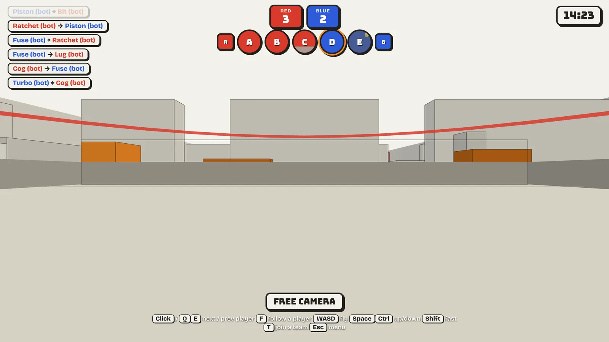
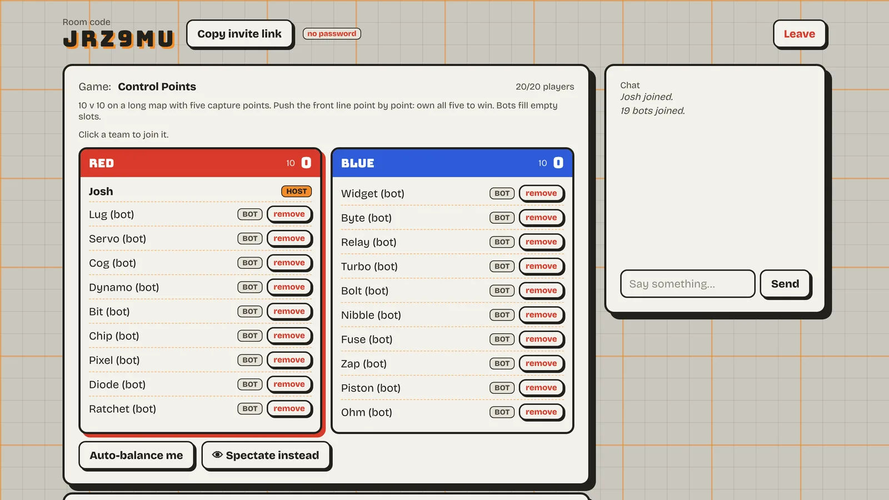
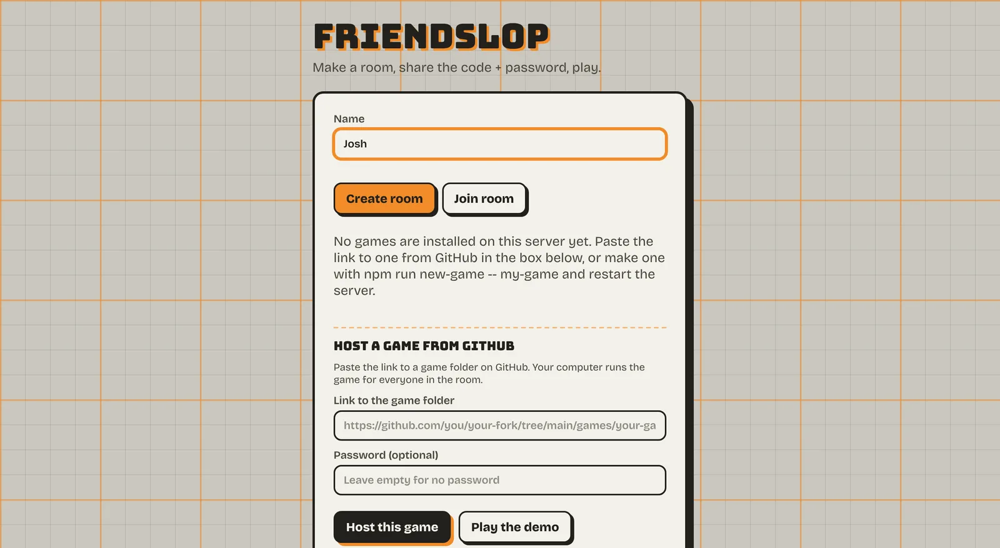

# friendslop: page text

Case-study page for joshuahickson.org, in Josh's voice (first person). The homepage leads with the
With triage system (Josh's pick); this is one of the project pages under it.

Three places still need Josh's own words. Each is marked **QUESTION FOR JOSH** with what to ask and
why. Everything else is ready for his read. Nothing here goes live without his yes on the final
version.

Media names refer to `handoff/media/`. Links refer to `handoff/links.md`.

---

## friendslop

**Send a link, play together. A free kit and server for small browser multiplayer games.**

Directed by Josh. The code was written by AI agents under my direction.

Status: working alpha, live at play.friendslop.us. Nobody outside has played it yet.

[Play the demo] (link: demo) · [Code on GitHub] (link: repo) · [friendslop.us] (link: site)

### Why I built it

**QUESTION FOR JOSH 1:** "In one or two sentences, why did you start friendslop?" A draft from
what's on record, for him to keep, change or replace: *Making a game is getting cheaper fast. Getting
a group of friends into the same game at the same time is still the hard part, so I wanted to see how
close I could get to "send a link, play".*

### What it does

- You open the site, make a room, and share the code and password. Friends join from a browser tab.
  Nobody installs anything.
- Bots join like players, so a 10 v 10 match works with two people.
- Anyone can host their own game by pasting a GitHub link. The game runs in the host's browser,
  inside a sandbox, and my server only passes messages along. It never runs a stranger's code.
- One free server carries every room, on a daily data budget.

The demo, Control Points, is a 10 v 10 low-poly shooter: push the front line point by point.

### How I worked

I set the direction and made the calls; agents wrote the code and the research notes, and I reviewed
each change before it went live. The decisions that shaped it:

- **The server never runs other people's code.** That's what makes free hosting by link safe enough
  to offer.
- **One free server instead of "host from your own PC".** Easier for players, and I took the cost and
  the limits on myself.
- **Privacy first.** The server stopped writing the room creator's IP address to its logs, and the
  site has a plain privacy page.
- **Open licence.** Apache-2.0, so other people can build on it.
- **It has to be funny.** Every error message tells you what happened and what to do, with a joke on
  top.

### What came out of it

- Built over one week, 25 to 31 October 2026: 70 commits, about 10,800 lines of JavaScript and 3,000
  lines of tests. All 142 tests on the main branch pass.
- **Data use cut by about 8 times.** The host's proxy stripped the browser's own compression, so the
  agents added compression inside the app. Measured live: 1.71 MB a minute per player before, 0.22
  after. The free plan's 150 MB a day now covers about 700 player-minutes instead of about 90.
- **Bot matches that end.** A fast-forward simulator of bot-only matches showed the front getting
  stuck for 6 to 16 minutes, and one team winning every match. After three fixes, 20 test matches all
  ended at about 15 to 17 minutes.
- **Firefox hosting fixed.** A Firefox host's match crashed at the start; one security-header change
  fixed it, checked on the live site.
- **Retro games, a spike.** A two-player NES game ran in lockstep in two browsers through the live site,
  each player with their own copy of the game file.

### What's missing: real players

This is the honest part. friendslop works and is tested, but nobody outside has played it, and I
haven't played it with friends yet either. Most of the testing so far was agents driving a browser.
Nothing in it counts players over time, so I can't show usage, only that it runs.

**QUESTION FOR JOSH 2:** "How do you want to say this in your own words?" Josh named this weakness
himself on Nov 2. His exact words can go here only with his yes, because whether things he typed to
agents get quoted word for word is still undecided. Until then, the paragraph above stands on its
own.

What's next:

1. A friends test on Saturday 7 November. **QUESTION FOR JOSH 3** (below) settles how to describe it.
2. A counter with no IP addresses and no names: rooms made, matches with two or more people, matches
   that finish.
3. A few recorded playtests, against a target set before looking.

### What it cost

**QUESTION FOR JOSH 4:** "Roughly what did friendslop cost, in money and in hours?" (Josh is fine
with rough numbers.) Known from the repo: hosting is on Render's free plan and the game files load
from a free CDN. Not known: the AI subscription or usage cost, the domain, and his hours. Drop this
section if he'd rather not.

### What I'd like advice on

Use the line from the portfolio's main pitch: *"I'm Josh. I built this. Here's my portfolio. Can you
please give me some career advice?"* If he wants a friendslop-specific ask, it could be: how to get
the first real players for a free tool like this, and what to measure first.

---

## QUESTION FOR JOSH 3: the Nov 7 line

Josh's Nov 2 note: the Nov 7 friends test "involves a 3d build of a game similar to Halo Wars 2
Terminus". Halo Wars 2 itself can't run on friendslop (see HANDBACK-NOV4.md). Until Josh says which
he means, the page says only: *"Next: a friends test on 7 November with a 3D co-op game."* Ask him:
"Is Nov 7 an original co-op base-defence game built on friendslop, or a night of the real Halo Wars 2?
And may the page name Halo Wars as the inspiration?"

## Notes for the page builder

- Josh's prose rule for anything he publishes: hyphens only, no em or en dashes, and no
  "this, not that" phrasing.
- Josh's pronouns are he/him. Other people are named by role only.
- Never say Josh can't code or doesn't read code, and don't say he wrote the code. "Agents wrote the
  code under my direction" is the line.
- Don't credit individual ideas to Josh or to the agents: "Directed by Josh" covers it.
- The demo banner change (no "Nobody at friendslop has played this yet" on the demo) is on branch
  `portfolio/nov4` only. Until Josh merges it, the live demo still shows that banner. The screenshots
  were taken on a local server with the change.
